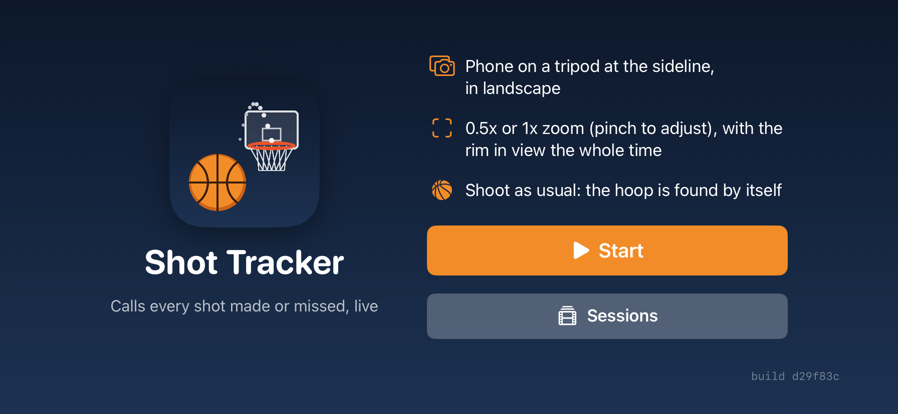
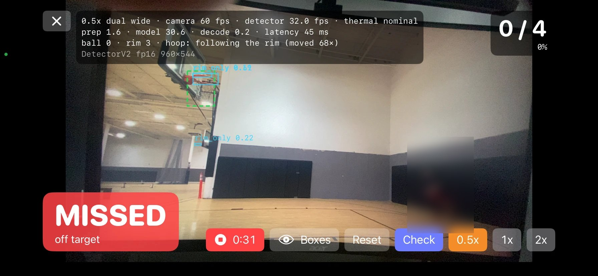
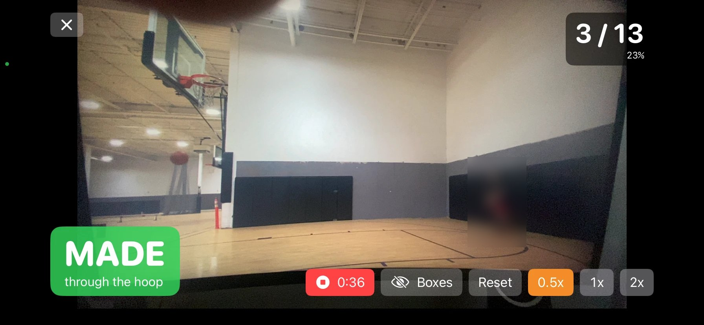
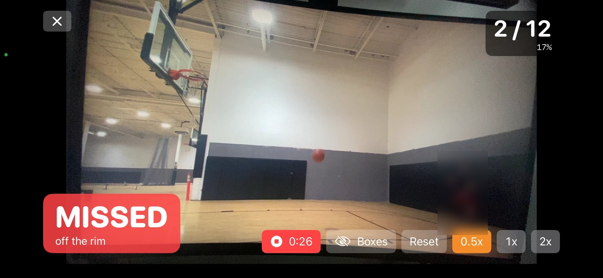
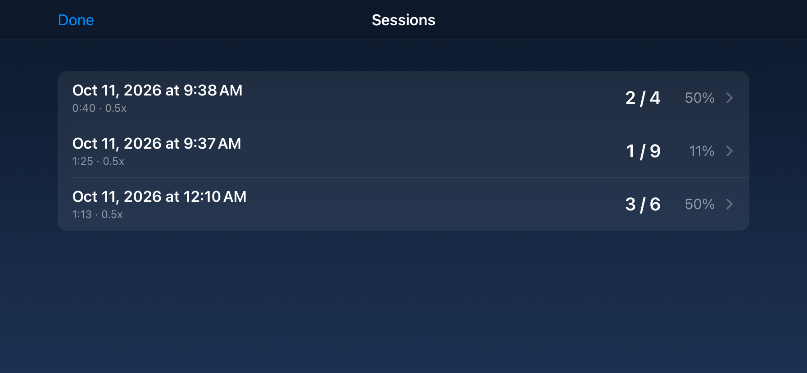
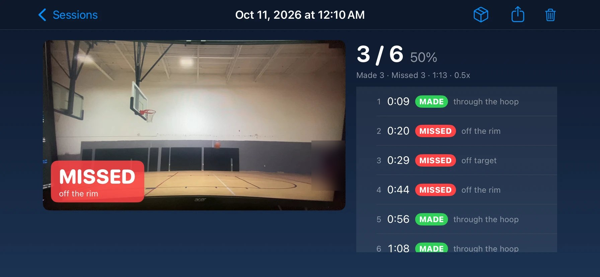
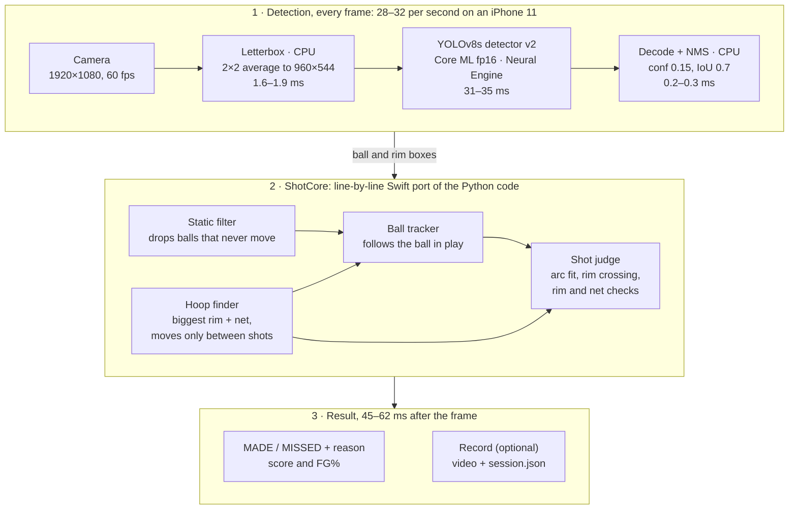

# Basketball Shot Tracker for iPhone

A phone on a tripod watches someone shoot and calls every shot **MADE** or **MISSED**, live, on the phone, with the
reason ("through the hoop", "off the rim", "fell past the rim", ...), a running count and FG%. Sessions can be
recorded, watched back with the calls, and exported for scoring.

Native Swift (SwiftUI, AVFoundation, Core ML), built and installed from Windows with
[xtool](https://github.com/xtool-org/xtool). The detector, tracker and shot rules come from the research repo,
[Basketball-Shot-Tracker](https://github.com/NathanielRecto/Basketball-Shot-Tracker), where they were trained and
evaluated: **85.6%** of shots found and called right on a first-look test in a gym the system had never seen
(90 shots, frozen code, scored once; offline).

**Status:** runs live on an iPhone 11 at about 30 detections per second. The phone is verified to run the research
system exactly (below); **live accuracy on the phone is not measured yet**: that needs new test sessions recorded
through the app. Full write-up with tables and charts: **[docs/REPORT.md](docs/REPORT.md)**.

| Start | Live, with boxes |
|---|---|
|  |  |
| **A make** | **A miss** |
|  |  |
| **Sessions** | **A session, played back with its calls** |
|  |  |

<sub>Screenshots from an iPhone 11 filming practice footage on a monitor; people are blurred.</sub>

## How it works



1. **Camera:** 1920 x 1080 at 60 frames per second in landscape. Each frame is shrunk to 960 x 540 with an exact 2x2
   average (the same pixels the research code's OpenCV resize gives) and padded to 960 x 544.
2. **Detector:** YOLOv8s ("detector v2"), converted to Core ML and run in 16-bit on the Neural Engine (~30 ms). It
   finds `ball`, `hoop` and `rim_only` boxes; the raw output is decoded with the research thresholds (confidence
   0.15, per-class non-maximum suppression at IoU 0.7). While the model runs one frame, the next is already prepared.
3. **Hoop:** the biggest rim the detector sees (the nearest hoop), median over the last ~1.6 s, plus the net below
   it. It is found automatically and follows the rim if the phone moves, but only between shots.
4. **Static filter, tracker, shot judge** (`Packages/ShotCore`, a line-by-line Swift port of the research code): drop
   detections that never move (brackets, spare balls), follow the one ball in play, fit its arc, and decide where it
   crosses the rim and what it does after (rim bounce, in and out, net braking, falling past the rim).

## Camera and lens

- Uses the **dual-wide camera** (ultra-wide + wide) and starts at **0.5x**, the research setup. **Pinch** the preview
  or tap **0.5x / 1x / 2x** to zoom up to 5x; the camera switches lenses by itself, beyond 1x the zoom is digital.
  The nearest preset button shows the actual zoom (e.g. "1.7x"). After a zoom change the hoop is found again.
- **Landscape only**, either way round; holding the phone upright does not rotate the picture.
- Phones without an ultra-wide lens fall back to the wide camera (zoom from 1x).

## Screens and buttons

| Screen | What it has |
|---|---|
| **Start** | App icon, setup tips (tripod at the sideline, 0.5x or 1x, keep the rim in view), **Start**, **Sessions**, and the app's build (git commit) bottom right |
| **Camera** | Live preview; **score** (made / shots, FG%) top right; **MADE / MISSED** banner with the reason after each shot |
| | **✕** back to Start (stops the camera, saves a recording in progress) |
| | **Record** / **■ 0:36**: record the session (video + the app's detections and calls) |
| | **Boxes** (eye): show or hide the detector boxes, the green hoop box, the white ring on the tracked ball and the speed readout (zoom, camera / detector fps, timings, thermal state, hoop status) |
| | **Reset**: count from zero |
| | **Check** (with Boxes on, development builds): runs the phone's detector on bundled dev frames and compares with PyTorch |
| | **0.5x / 1x / 2x**: zoom presets |
| **Sessions** | Recorded sessions, newest first: date, length, zoom, made / shots, FG%; swipe to delete |
| **Session** | The video (system player: play, scrub, full screen) with the MADE / MISSED banner at each call; stats; the shot list (tap a shot to jump to it); **Export session** (zip of the video + `session.json`), **Share** (video), **Delete** |

Recordings stay inside the app (not in the Files app); **Export session** is the way to take one to a PC, where
`Python_Raw/scripts/import_phone_session.py <zip>` replays it through the Python code (it must make the same calls)
and, with `--labels`, scores it against hand labels.

## Model and data

- **Detector v2:** YOLOv8s, fine-tuned in two stages: from COCO weights for 30 epochs on the hotshot dataset (v1, best
  epoch 29), then from v1 for 12 epochs on 8,347 images (hotshot plus 5,324 gym frames from Basketball Detection v6,
  both CC BY 4.0). Validation mAP50 0.851 (ball 0.747, hoop 0.931, rim only 0.876). Converted with
  `Python_Raw/scripts/export_coreml.py`; the weights are not in git.
- **Data split:** whole sessions, fixed before filming. Own footage: first gym sessions 1-4 and second gym freestyle
  sessions 5, 9-11 are **dev** (tuning); second gym sessions 6-8 (30 free throws, 30 mid-range, 30 threes) are the
  **test**, labelled blind and scored once. Every phone check below used dev data only.

## Results

| | Result |
|---|---|
| First-look test, unseen gym (offline Python, 90 shots) | **85.6%** end-to-end (95% CI 77-91%); shot detection precision 100%, recall 96.7%; "made" precision 97.7%, recall 82.7%, F1 89.6% |
| Phone detector vs PyTorch (24 dev frames, 60 boxes) | fp32 identical; fp16 (live) all 60 matched, IoU 0.988, corners within 0.7 px |
| Swift tracker + shot judge vs Python (4 golden cases) | Identical on 33,386 frames and 123 shot calls |
| Real phone recordings replayed in Python | Same calls (latest: 6 of 6) |
| Speed on an iPhone 11 | Camera 60 fps, detector 28-32 fps, 45-60 ms from frame to call |
| Dev accuracy at the phone's frame rates | 94.7% at 60 fps; 90-94% at 20-30 fps |
| **Live accuracy on the phone** | **Not measured yet** |

Details, definitions (precision, recall, F1, over- and underfitting) and charts: [docs/REPORT.md](docs/REPORT.md).

## Limits

- Tripod use is what the research measured. Following the rim helps a hand-held phone but lags it by ~1.5 s
  and has not been evaluated offline (every research result uses one fixed hoop per video).
- At ~20-28 fps, dev accuracy is 90-94% against 94.7% at 60 fps; the first gym (low camera, close to the hoop)
  loses the most.
- One camera from the sideline cannot see depth: a ball dropping just in front of the net can look like a make or a
  miss; most test errors were makes called "fell past the rim".
- Only 0.5x was measured in the research; 1x should behave the same (the rules are in rim widths), digital zoom above
  ~2x is softer. One hoop, one ball, one shooter at a time; tested on an iPhone 11.

## Layout

```
Packages/ShotCore/          pure Swift, no Apple frameworks: `swift test` runs on Linux / WSL
  Sources/ShotCore/         letterbox, YOLO decode + per-class NMS, exact 2x2 resize, parity matching,
                            and the port: Flight (arc fit), Tracking, ShotLogic, Pipeline, HoopFinder, Config
  Tests/ShotCoreTests/      unit tests + GoldenTests (Fixtures/: detections only, no images)
Sources/ShotTracker/        the app: StartView, LiveView, CameraController, Detector (Core ML, two stages),
                            ShotSession, SessionRecorder, SessionsView, SessionStore, BuildInfo, ParityCheck, Theme
Assets/AppIcon.png          the icon, drawn by scripts/make_icon.py
docs/                       REPORT.md, its charts (make_report_figures.py) and screenshots
Resources/                  local only (gitignored): the Core ML model, optional parity frames, build.json
scripts/                    build.sh (stamp + install), sync_model.sh (copy the model in), make_icon.py
```

## Build and run (Windows)

One-time setup, following xtool's
[Linux / WSL guide](https://github.com/xtool-org/xtool/blob/main/Documentation/xtool.docc/Installation-Linux.md):

1. WSL with Ubuntu; in it, Swift 6.4 ([swiftly](https://swift.org/install/linux)), its packages, `usbmuxd`,
   `libimobiledevice-utils`, and the xtool AppImage on the PATH.
2. `xtool setup`: sign in with an Apple ID (free accounts work; xtool suggests a separate Apple ID), and give it
   the path to `Xcode.xip` so it builds the iOS SDK.
3. iPhone connection: usbipd's USB pass-through broke large transfers here (installs timed out), so the phone
   connects through Windows instead. Install **Apple Devices** from the Microsoft Store; allow TCP 27015 inbound on
   the `vEthernet (WSL)` adapter; forward it with
   `netsh interface portproxy set v4tov4 listenport=27015 listenaddress=<WSL gateway IP> connectport=27015 connectaddress=127.0.0.1`
   (admin); and in Ubuntu
   `export USBMUXD_SOCKET_ADDRESS="$(ip route list default | awk '{print $3}'):27015"`
   (in `~/.profile`). Re-run the `netsh` line if `xtool devices` comes up empty after a reboot.
4. On the iPhone: Developer Mode on, then trust the developer certificate (Settings > General > VPN & Device
   Management).

The model (not in git, like the research repo's weights):

```bash
cd ../Python_Raw && ~/coreml-env/bin/python scripts/export_coreml.py                       # WSL: coremltools has no Windows wheels
~/coreml-env/bin/python scripts/export_coreml.py --quantize 32 --name DetectorV2_fp32     # optional, for the parity check
python scripts/export_parity_frames.py                                                     # optional, dev frames only
cd ../iOS && scripts/sync_model.sh
```

Then, in Ubuntu from this folder:

```bash
scripts/build.sh             # stamp the git commit, then build, sign and install (xtool dev run -c release)
scripts/build.sh --udid ID   # another phone (`xtool devices`); run scripts/sync_model.sh --no-parity first
cd Packages/ShotCore && swift test
```

The phone compiles the model once on first launch (no Mac to compile it at build time) and caches it.
