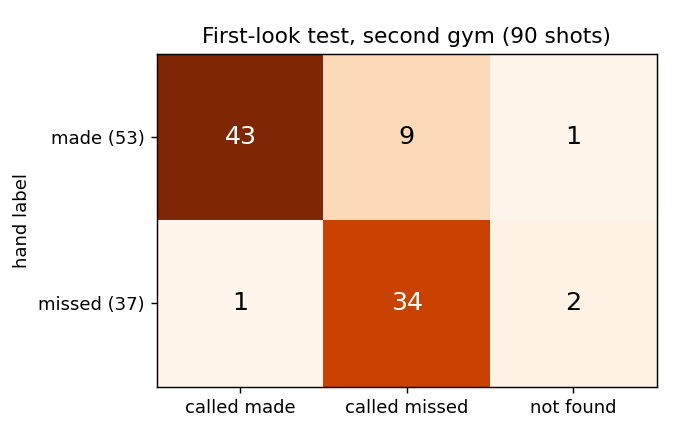
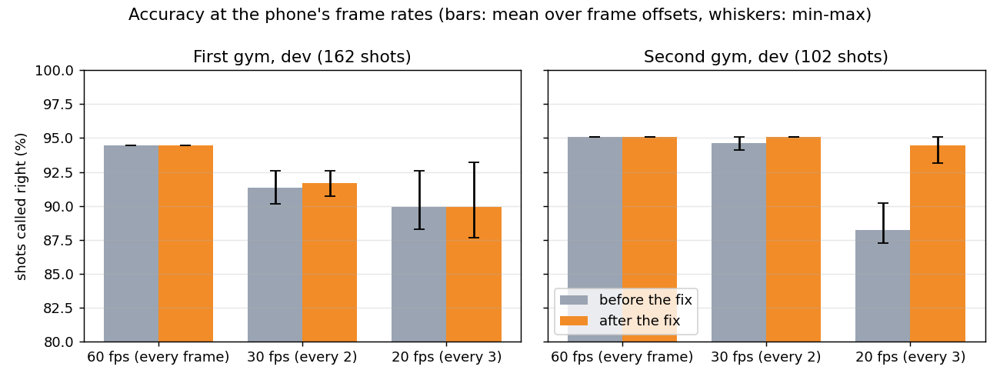
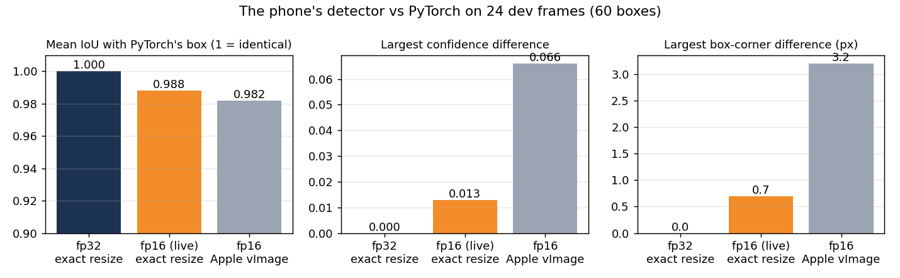
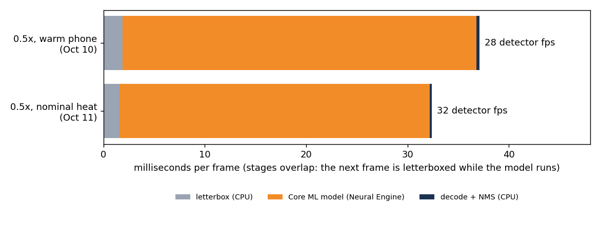

# Report: live shot tracking on an iPhone

What the iPhone app does, how its parts were built and checked, and how accurate it is, with every number traced to
a measurement. The detector, tracker and shot rules were developed and evaluated in the research repo,
[Basketball-Shot-Tracker](https://github.com/NathanielRecto/Basketball-Shot-Tracker) (its
[RESULTS.md](https://github.com/NathanielRecto/Basketball-Shot-Tracker/blob/main/docs/RESULTS.md) is the full research
write-up); this report covers what it took to run that system live on a phone, and states plainly what is and is not
measured yet.

**Summary**

| Question | Answer | Status |
|---|---|---|
| How accurate is the system on unseen footage? | **85.6%** of 90 shots found and called right (95% CI 77-91%), new gym, frozen code, scored once | Measured offline (Python) |
| Does the phone run the same system? | Detector boxes match PyTorch's (fp32 identical; fp16 within 0.7 px); tracker + shot judge identical on 33,386 frames; Python replays of real phone recordings make the same calls | Measured |
| How fast is it on an iPhone 11? | Detector 28-32 frames per second on 60 fps video, ~45-60 ms from frame to call | Measured |
| Does the lower frame rate cost accuracy? | Dev footage: 94.7% at 60 fps, 90-94% at the phone's 20-30 fps after a fix | Measured (dev) |
| How accurate is it live on the phone? | Not measured yet: needs new test sessions recorded through the app | **Open** |

## Contents

1. [Definitions](#1-definitions)
2. [Languages and tools](#2-languages-and-tools)
3. [Data and how it was split](#3-data-and-how-it-was-split)
4. [The detector: model and training](#4-the-detector-model-and-training)
5. [Methods: algorithms and filters on the phone](#5-methods-algorithms-and-filters-on-the-phone)
6. [Results](#6-results)
7. [Overfitting and underfitting in this project](#7-overfitting-and-underfitting-in-this-project)
8. [Limitations](#8-limitations)
9. [Reproducing this report](#9-reproducing-this-report)

## 1. Definitions

| Term | Meaning here |
|---|---|
| **Shot found** | A labelled shot the system also reported, within 1.5 s of the label |
| **Accuracy (end-to-end)** | Shots found **and** called right (made / missed) divided by all labelled shots. The headline metric: a missed shot counts as wrong |
| **Precision** | Of the things the system reported, the share that were right. For shots: reported shots that were real shots. For "made": calls of made that were makes |
| **Recall** | Of the things that were there, the share the system got. For shots: labelled shots it found. For "made": makes it called made |
| **F1 score** | The harmonic mean of precision and recall, 2PR / (P + R): high only when both are high |
| **Confusion matrix** | A table of hand label (rows) against the system's answer (columns) |
| **95% CI** | Wilson score interval: with this many shots, the range the true accuracy very likely lies in |
| **IoU** | Intersection over union of two boxes: overlap area / combined area; 1 = identical boxes |
| **mAP50 / mAP50-95** | Object-detection score: average precision over classes, counting a box as right at IoU >= 0.5 (or averaged over 0.5-0.95) |
| **Training / validation set** | Images the detector learned from / images held out to judge it during training |
| **Dev (development) data** | Footage used to build, debug and tune the tracker and rules. Results on it are optimistic |
| **Test data** | Footage set aside **before** filming, never looked at while tuning, scored **once** with frozen code. The honest number |
| **Frozen / fingerprinted** | The exact code commit and model file hash recorded before a test, so the result can be tied to them |
| **Overfitting** | A model or rule that fits the data it was built on better than new data: good dev or training scores, worse test scores. Typical causes: tuning to a few examples, too many free parameters, data from one place |
| **Underfitting** | A model too weak or too narrowly trained to do well even on its own data: poor training and test scores alike |
| **fp16 / fp32** | 16-bit / 32-bit floating-point numbers. The iPhone's Neural Engine runs fp16, which is faster but slightly less exact |

## 2. Languages and tools

**Languages**

| Language | What it is | Used for |
|---|---|---|
| **Swift 6** | Apple's compiled, type-safe programming language for iOS / macOS apps (also runs on Linux) | The whole app and the ShotCore library (the app target uses the Swift 5 language mode) |
| **SwiftUI** | Apple's declarative user-interface framework for Swift | Every screen |
| **Python 3** | General-purpose interpreted language, the standard for machine learning | Training, evaluation, model conversion, the reference tracker, importing phone sessions (research repo) |
| **Bash** | Unix shell scripting language | Build and model-copy scripts (`scripts/build.sh`, `scripts/sync_model.sh`) |
| **JSON / YAML / XML plist** | Data formats | Recordings and fixtures (JSON), xtool config (YAML), app settings (`Info.plist`) |

**Frameworks and tools**

| Tool | What it is | Used for |
|---|---|---|
| **YOLOv8 (Ultralytics) + PyTorch** | A one-stage object-detection network and the deep-learning library it runs on | The ball / hoop / rim detector (trained in the research repo) |
| **Core ML + coremltools** | Apple's on-device machine-learning runtime, and its Python converter | Running the detector on the iPhone's Neural Engine; converting the PyTorch model |
| **AVFoundation / AVKit** | Apple's camera, video recording and playback frameworks | 1080p60 capture, dual-wide zoom, HEVC recording, playback |
| **Accelerate (vImage)** | Apple's fast image-processing library | Fallback resize (the exact 2x2 average is used instead, see §5) |
| **SwiftPM + Swift Testing** | Swift's package manager and test framework | Building, and the 22 ShotCore tests incl. the golden comparison |
| **xtool** | An open-source replacement for Xcode's build / sign / install steps that runs on Linux | Building and installing the app from Windows, free Apple ID signing |
| **WSL (Ubuntu) + swiftly** | Windows Subsystem for Linux, and Swift's toolchain installer | The Linux environment the iOS build runs in |
| **Apple Devices + usbmuxd** | Apple's Windows app (iPhone driver) and the Linux iPhone-connection service | Reaching the iPhone from WSL (a TCP relay; USB pass-through failed, §8) |
| **OpenCV, NumPy, Pillow, matplotlib** | Image, numeric, image-file and plotting libraries for Python | Reading video, labelling, figures, the app icon |
| **pytest, git / GitHub** | Python test runner; version control and hosting | 110 Python tests; both repos |

## 3. Data and how it was split

The app has no training data of its own: it runs the research repo's detector and rules. Every check in this report
used **dev** data only; the test sessions were not touched.

| Data | Size | Used for | Split |
|---|---|---|---|
| hotshot detector dataset (CC BY 4.0) | 3,625 images | Detector training (v1, v2) | Publisher's train / valid / test split |
| Basketball Detection v6, Hooper (CC BY 4.0) | 5,324 frames (every 8th of 48,110) | Detector v2 training | Validation held out in whole 2,000-frame blocks (no near-duplicate leakage) |
| Own sessions, first gym (1-4) | 162 hand-labelled shots | Building and tuning the tracker | **Dev** (2-4 were a test once; re-used as dev after scoring) |
| Own sessions, second gym, freestyle (5, 9, 10, 11) | 102 shots | Tuning, frame-rate study, parity frames | **Dev** |
| Own sessions, second gym, FT / mid / threes (6, 7, 8) | 90 shots | **First-look test** | **Test**, fixed before filming, scored once |
| Public phone videos | 103 test / 98 dev shots | Earlier tests | Dev / test by video, fixed before scoring |
| Phone parity frames | 24 frames, 60 boxes | Phone detector vs PyTorch (§6.3) | 3 frames from each **dev** session |
| Golden cases | 4 cases, 33,386 frames, 123 calls | Swift vs Python (§6.5) | Simulator + **dev** sessions 1, 2, 5 |

Splits are by **whole session or video**, never by frame, because frames of one session are near copies of each other
and would make a held-out score look better than it is. Labels were made **blind**: the labelling tool never shows the
system's calls.

## 4. The detector: model and training

**Model: YOLOv8s** (small), three classes: `ball`, `hoop` (rim + net) and `rim_only` (a rim without its net; used only
to find the hoop). Detector v2 was fine-tuned from v1 for 12 epochs on 8,347 images (hotshot + Hooper) at 960 px,
batch 2, 8 hours on a GTX 1660 SUPER (research repo, RESULTS §6).

| Validation (880 images) | Precision | Recall | mAP50 | mAP50-95 |
|---|---|---|---|---|
| All classes | 0.871 | 0.823 | 0.851 | 0.433 |
| Ball | 0.865 | 0.637 | 0.747 | 0.441 |
| Hoop (rim + net) | 0.883 | 0.982 | 0.931 | 0.390 |
| Rim only | 0.867 | 0.850 | 0.876 | 0.466 |

| Training curves | Precision-recall | Confusion matrix |
|---|---|---|
|  |  |  |

Both training and validation loss fall through all 12 epochs and validation loss never turns up: no overfitting, and
the best epoch was the last (the model was still improving slightly when training stopped).

**Conversion for the phone** (`Python_Raw/scripts/export_coreml.py`): the PyTorch model is exported to Core ML without
its post-processing (NMS), at a fixed 960 x 544 input, in fp16 for the Neural Engine (and fp32 as a reference). The app
re-implements the post-processing exactly (§5), so the phone and Python use the same thresholds (confidence 0.15,
per-class NMS at IoU 0.7, at most 300 boxes).

## 5. Methods: algorithms and filters on the phone

Each frame goes through this chain; the shot logic is a line-by-line Swift port of the research code.

| Step | Method | Why |
|---|---|---|
| Camera | 1080p at 60 fps, dual-wide camera (0.5x ultra-wide to 1x wide, digital to 5x), landscape only | The research footage settings |
| Letterbox | Scale 1920 x 1080 to 960 x 540 by an exact 2x2 average (OpenCV's own result for a half-size resize), centre on grey 114 to 960 x 544 | The same pixels PyTorch saw in training and evaluation |
| Detector | YOLOv8s in Core ML on the Neural Engine, fp16 | ~30 ms per frame |
| Decode + NMS | Best class per anchor, keep if score > 0.15 (compared in fp32 like PyTorch), greedy non-maximum suppression per class at IoU 0.7 | Identical to Ultralytics |
| Pipelining | Frame N+1 is letterboxed on the camera queue while the model runs frame N; at most 2 frames in flight, extra camera frames skipped | Keeps the Neural Engine busy: 22 -> 28-32 fps |
| Hoop finder | Biggest `rim_only` box per frame (the nearest hoop), median over ~1.6 s, plus the net (1.27 rim widths) | Python's `find_hoop`; matched hand-marked hoops at IoU 0.82-0.93 |
| Hoop following | The same median over a rolling window; the hoop moves only between shots and only after >0.15 rim widths of change | A hand-held or bumped phone (phone-only behaviour) |
| Static filter | Drops ball detections that stay in one place (>=15% of frames over 8 s, spread over >=3 s) | Rim brackets, spare balls |
| Ball tracker | Constant-velocity gate, side tracks for other candidates, switch to a fast riser, wait for a ball that left the top of the frame | One ball, many look-alikes (heads, hands) |
| Shot judge | State machine (idle, flight, confirm, rattle): arm above the rim, least-squares arc fit (Cramer's rule), rim-line crossing, rim bounce / rim out / net braking / net catch / front-rim contact checks, all distances in rim widths | Made or missed, with a reason |
| Frame-rate fix | The "ball still held" check uses a speed times the detector's median frame interval | Works at 20-60 fps (§6.2) |

## 6. Results

### 6.1 Accuracy on unseen footage (offline, Python)

The cleanest measurement of the system: a second gym no part of the system had seen, test split fixed before
filming, labels made blind, code frozen (commit `c78a239`, detector v2 `e90e448a...`), scored once. The phone runs the
same system (§6.3-6.5), but this run itself was offline.

| Test: sessions 6-8, 90 shots | Result |
|---|---|
| **End-to-end accuracy** | **85.6%** (77 of 90; 95% CI 77-91%) |
| Free throws / mid-range / threes | 76.7% / 90.0% / 90.0% |
| Shot detection: precision / recall / F1 | 100% / 96.7% / 98.3% (87 found, none invented) |
| Made vs missed on found shots: accuracy | 88.5% (77 of 87) |
| "Made": precision / recall / F1 | 97.7% (43/44) / 82.7% (43/52) / 89.6% |
| "Missed": precision / recall / F1 | 79.1% (34/43) / 97.1% (34/35) / 87.2% |

The errors lean one way: **9 makes were called missed** (8 by the "fell past the rim" check, which looks for a ball
that keeps falling fast after the rim; from a sideline camera a ball dropping just in front of the net looks the same),
only 1 miss was called made, and 3 shots off the front rim were not found. Since the test, two fixes for exactly these
errors (net catch, front-rim contact) were made on dev data; they need new test footage to be measured.

### 6.2 Frame rate: does the phone's lower rate cost accuracy?

The phone runs the detector on every second or third camera frame. Replaying the saved dev detections with only every
Nth frame showed a frame-rate dependence (a per-frame "ball held" threshold), fixed by measuring it per second:

| Dev shots called right | First gym (162) | Second gym (102) |
|---|---|---|
| 60 fps (every frame) | 153 -> 153 | 97 -> 97 |
| 30 fps (every 2nd), 2 offsets | 150, 146 -> 150, 147 | 97, 96 -> 97, 97 |
| 20 fps (every 3rd), 3 offsets | 150, 144, 143 -> 151, 144, 142 | 89, 92, 89 -> **97, 97, 95** |

(Before -> after.) 60 fps is unchanged, the second gym recovers fully at 20 fps, and the first gym (low camera, close to
the hoop) still loses up to 11 shots at 20 fps: more frames per second is the remaining lever there.

### 6.3 The detector on the phone matches PyTorch

The app's **Check** button runs its own detector on 24 dev frames saved as PNG (identical pixels on both sides) and
compares with PyTorch's boxes:

| 60 PyTorch boxes | Matched | Missed / extra | IoU mean (min) | Max confidence difference | Max corner difference |
|---|---|---|---|---|---|
| fp32, exact resize | 60 | 0 / 0 | 1.000 (0.999) | 0.000 | 0.0 px |
| **fp16, exact resize (live)** | 60 | 0 / 0 | 0.988 (0.959) | 0.013 | 0.7 px |
| fp16, Apple vImage resize | 60 | 0 / 1 | 0.982 (0.940) | 0.066 | 3.2 px |

fp32 reproduces PyTorch exactly, so preprocessing, decoding and NMS are identical; fp16 moves boxes by under a pixel.
Apple's resize (a sharper filter) was 5 times further off, which is why the exact 2x2 average is used.

### 6.4 Speed on an iPhone 11

| | Value |
|---|---|
| Camera | 60 fps (1080p) |
| Detector | 28-32 fps (25 while recording video) |
| Per frame | letterbox 1.6-1.9 ms, model 30.6-34.9 ms, decode + NMS 0.2-0.3 ms |
| Frame to call | 45-62 ms |

A first two-stage version ran at only ~10 fps because the decoder was a generic function called across a module
boundary (not specialised by the compiler: 24 ms per frame); a non-generic version takes 0.3 ms.

### 6.5 The tracker and shot judge are the same code

The Swift port is checked against **golden cases** exported from the Python code (`swift test`): for every frame the
tracked ball and track switches, and every shot call and decision-log line, compared **exactly** as 64-bit numbers.

| Case | Frames | Shot calls | Result |
|---|---|---|---|
| Simulator (every shot type, noise, decoys) | 884 | 7 | Identical |
| Own session 1 (first gym, dev) | 11,729 | 44 | Identical |
| Own session 2 (first gym, dev) | 15,059 | 42 | Identical |
| Own session 5 at every 3rd frame (second gym, dev; the phone's rate) | 5,714 | 30 | Identical |

A deliberate change (fixing the frame interval at 1/60 s) makes three of the four cases fail, so the check is not
vacuous. The app's settings must equal the Python's `params.json`, key for key.

### 6.6 Real phone recordings, replayed in Python

The app's recordings hold every frame's detections, the hoop events and the build's git commit; the research repo's
`import_phone_session.py` replays them through the Python code and compares the calls.

| Recording | Detector fps | Hoop events | Calls | Python replay |
|---|---|---|---|---|
| 30 s, 0.5x, hand-held (format 1) | 25.2 | 9 | 4 | 4 of 4 identical |
| 64 s, 1x (judge already running at Record) | 32.1 | 20 | 6 | 5 of 6 identical; 1 released before Record (expected) |
| **74 s, 0.5x, build `d29f83c`** | 31.5 | 14 | 6 | **6 of 6 identical** |

From build `d29f83c` the shot judge restarts when recording starts, so a recording holds everything the judge saw and
replays exactly. These recordings filmed a monitor and were not labelled: they check the phone, not accuracy.

## 7. Overfitting and underfitting in this project

| Where | What happened | Kind |
|---|---|---|
| Original detector + tracker on own gym footage | 13.4% end-to-end: the detector, trained on ~4 mostly broadcast source videos, fired on heads and legs, and the single-target tracker locked onto them | **Underfitting** to the task (too little, too different data, too simple a tracker): tracker v2 -> 37.8%, then detector v2 -> 78.2% on the same test |
| Dev vs test, original system | 88.8% on dev videos, 77.7% on held-out test videos | Mild **overfitting** of rules tuned on dev; why every headline number is a test result |
| Detector v3 (8 more epochs) | Validation mAP50 0.851 -> 0.866, but dev shot calls fell 93.9% -> 88.8% | **Overfitting** to the validation images' style; not used |
| Detector v4 (+600 frames from one gym) | Better on that gym's frames, but stopped finding the hoop in the second gym | **Overfitting** to one gym; not used |
| `net_brake_ratio` 1.24 | Would have saved one public dev shot | Rejected as overfitting a single example |
| Detector v2 training | Training and validation loss both fall, validation never turns up | No sign of overfitting |
| Dev now vs the second-gym test | Dev 93-95% today, test 85.6% (the test predates the later fixes, so not like-for-like) | The fixes since are dev-only until re-tested |

Guarding against overfitting here means: splits fixed before filming, by whole session; blind labels; tuning only on
dev; a test scored once with frozen code; and rejecting changes that help one example.

## 8. Limitations

* **Live accuracy is not measured yet.** Everything shows the phone runs the research system faithfully; the
  live number needs new test sessions recorded through the app, labelled blind and scored once.
* **One camera from the sideline cannot see depth:** a ball dropping just in front of or behind the net can look like a
  make (most test errors). More camera angles, or watching the net move, would help.
* **Frame rate:** ~20-30 detections per second instead of 60 costs up to 11 of 162 dev shots in the first gym.
* **Zoom:** all research footage was 0.5x. 1x should behave the same (rules are in rim widths) but is unmeasured;
  digital zoom above ~2x is softer.
* **Hand-held use:** the hoop follows the rim but lags about 1.5 s; never evaluated offline (research used a fixed hoop).
* **One hoop, one ball, one shooter at a time**, indoor gyms like the training data; outdoor courts were only tested
  offline on public videos.
* **iPhone 11 tested only.** Phones without an ultra-wide lens start at 1x.
* **USB pass-through (usbipd) did not work** for installing from WSL (corrupted large transfers); the Apple Devices relay
  is required on Windows.

## 9. Reproducing this report

* Figures: `python docs/make_report_figures.py` (numbers inline, sources in its comments).
* Golden comparison: `cd Packages/ShotCore && swift test` (Linux / WSL or a Mac).
* Detector match: the app's **Check** button (needs `Python_Raw/scripts/export_parity_frames.py` + `scripts/sync_model.sh`).
* Frame-rate study and the 90-shot test: the research repo (`scripts/replay_eval.py --stride`, RESULTS §9, §13).
* Phone replays: `Python_Raw/scripts/import_phone_session.py <exported zip>`.
* Screenshots: the people in camera screenshots are blurred.
